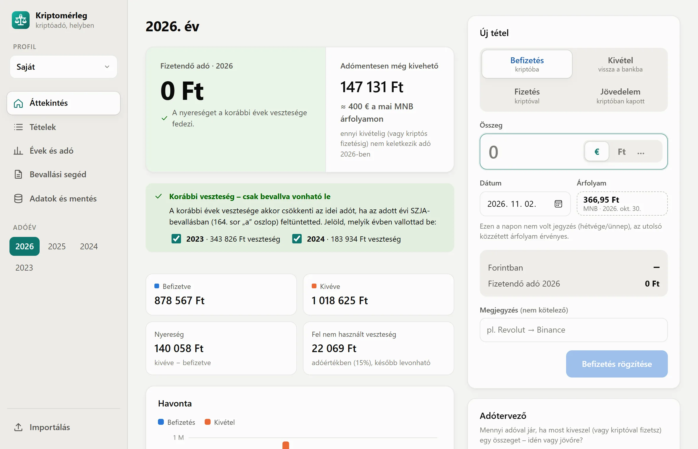

<p align="center"></p>

# Kriptomérleg

**A kriptóadód, a saját gépeden.** Asztali alkalmazás (Windows, Linux, NixOS) a kriptóba befizetett és onnan kivett összegek nyilvántartására és a magyar kriptó-SZJA kiszámítására – fiók és felhő nélkül, minden adat helyben marad.

[Weboldal](https://adamgyongyosi.github.io/kriptomerleg/) · [Letöltés](https://github.com/adamgyongyosi/kriptomerleg/releases/latest) · [Változásnapló](CHANGELOG.md)

<p align="center"></p>

> Tájékoztató számítás, nem adótanácsadás.

## Mit tud

- **Gyors rögzítés:** befizetés, kivétel, fizetés kriptóval, kriptóban kapott jövedelem; EUR, USD, GBP, CHF vagy forint. A devizás tételekhez az MNB hivatalos árfolyamát a teljesítés napjára automatikusan lekéri; közben élőben látszik, mennyivel változik az évi adó.
- **Adószámítás** az Szja tv. 67/C. § szerint: éves eredmény, 15% SZJA, adókiegyenlítés a bevallott veszteségekkel, 2022 előtti tételek, kisértékű ügylet. Részletek: [docs/adoszamitas.md](docs/adoszamitas.md).
- **Tőzsdei import:** Binance, Revolut, Kraken, Bybit és Crypto.com export, banki kivonat, régi Excel; Binance, Bybit és Kraken közvetlenül, csak olvasó API kulccsal. Újraimportálás nem duplikál, a más forrásból már meglévő napot jelzi. Részletek: [docs/import.md](docs/import.md).
- **Ügyletszintű nyomkövetés:** minden importált napi tétel mögött ott vannak az eredeti sorok és a forrásfájl ujjlenyomata – a DAC8-as (2027-től) NAV-összevetéshez.
- **Ellenőrzés:** jelzi a hiányzó vételt, a dupla tételt, a hézagos vagy régi importot.
- **Adótervező:** egy tervezett kivétel adója idén vagy jövőre, és belefér-e a kisértékű ügylet keretébe; az Áttekintésen az is látszik, mennyi vehető még ki adó nélkül.
- **Bevallási segéd:** mit kell a 25SZJA 164. sorába és a 06-os lap 202–209. sorába írni; önellenőrzés-segéd a kimaradt veszteségekhez; határidő-emlékeztető.
- **Export és mentés:** éves nyilvántartás PDF-ben, Excel és CSV, mentés fájlba (jelszóval titkosítva is), heti automatikus mentés, több profil (pl. családtagnak).
- **Automatikus frissítés** (kikapcsolható).

## Letöltés

A legfrissebb kiadás a [Releases](https://github.com/adamgyongyosi/kriptomerleg/releases/latest) oldalon:

| Fájl | Rendszer |
|---|---|
| `kriptomerleg_windows_x64-setup.exe` | Windows telepítő |
| `kriptomerleg_windows_x64-portable.exe` | Windows, telepítés nélkül |
| `kriptomerleg_linux_amd64.deb` | Debian / Ubuntu: `sudo apt install ./kriptomerleg_linux_amd64.deb` |
| `kriptomerleg_linux_amd64.AppImage` | bármely Linux: `chmod +x`, majd futtatás |

A fájlnevekben nincs verziószám, így a `…/releases/latest/download/<fájlnév>` link mindig a legújabbra mutat. Minden `main`-re pusholt változásból új kiadás készül; a verziókat és a változásokat a [CHANGELOG.md](CHANGELOG.md) sorolja fel.

## NixOS

```bash
nix run github:adamgyongyosi/kriptomerleg
```

Rendszerszintű telepítés flake-alapú konfigurációban:

```nix
# flake.nix
inputs.kriptomerleg.url = "github:adamgyongyosi/kriptomerleg";

# configuration.nix (a modulnak átadott inputs-szal)
environment.systemPackages = [ inputs.kriptomerleg.packages.${pkgs.stdenv.hostPlatform.system}.default ];
```

Alternatíva: az AppImage `appimage-run`-nal (`programs.appimage.enable = true;`).

## Adatok

Minden adat helyben, profilonként egy SQLite fájlban van; az app csak az MNB árfolyamot, a frissítéseket (kikapcsolható) és – ha kéred – a tőzsdei API-t éri el.

| Rendszer | Hely |
|---|---|
| Windows | `%APPDATA%\hu.kriptoado.app\` |
| Linux / NixOS | `~/.local/share/hu.kriptoado.app/` |

Táblák, mentésformátum, export: [docs/adatok.md](docs/adatok.md).

## Dokumentáció

| | |
|---|---|
| [Az adószámítás szabályai](docs/adoszamitas.md) | 15% SZJA, adókiegyenlítés, bevallott veszteség, kisértékű ügylet, példa |
| [Tőzsdei import](docs/import.md) | exportok letöltése tőzsdénként, API-s lekérés, hogyan számol |
| [Adatok, mentés, export](docs/adatok.md) | adatmappa, táblák, titkosított mentés, Excel/CSV/PDF |
| [Fejlesztés és build](docs/fejlesztes.md) | parancsok, tesztek, verzió és kiadás, frissítő, csomagtárak, felépítés |
| [Biztonság](docs/biztonsag.md) | CSP, jogosultságok, titkok, repóvédelem, függőség-audit |
| [Weboldal](docs/weboldal.md) | landing oldal, képernyőképek, animációk, SEO |
| [Példafájlok](examples/README.md) | importálható minta minden formátumhoz |
| [Arculat](brand/README.md) | logó, színek, hangnem |

## Fejlesztés

```bash
npm install
npm run tauri dev
```

Tesztek: `npm test` (felület) és `cargo test --manifest-path src-tauri/Cargo.toml` (Rust). Minden változás a [CHANGELOG.md](CHANGELOG.md) `[Unreleased]` szakaszába kerül; a részleteket a [docs/fejlesztes.md](docs/fejlesztes.md) írja le.
